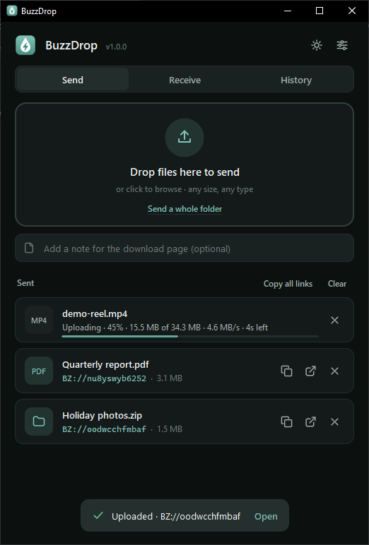
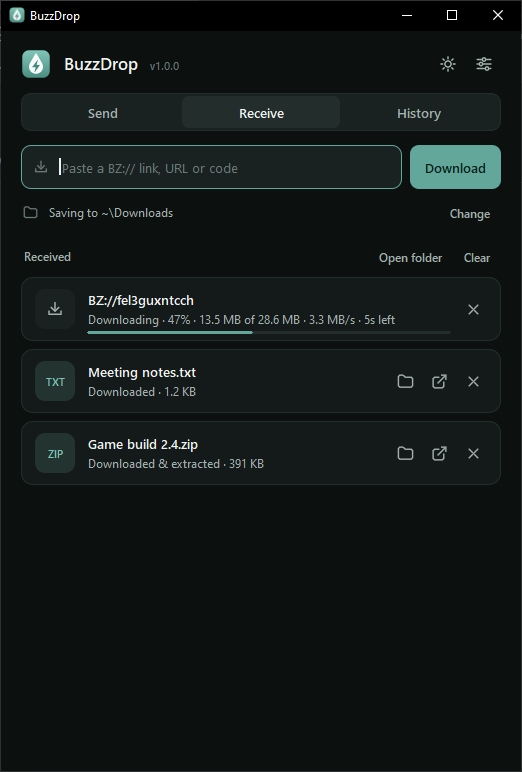
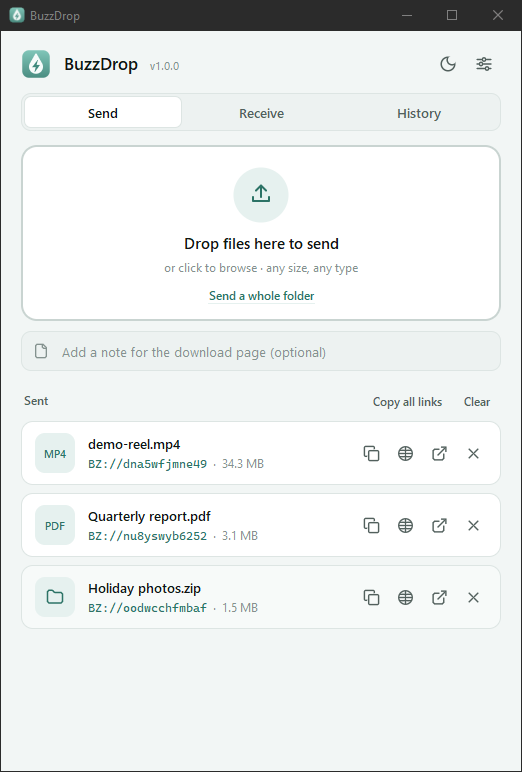
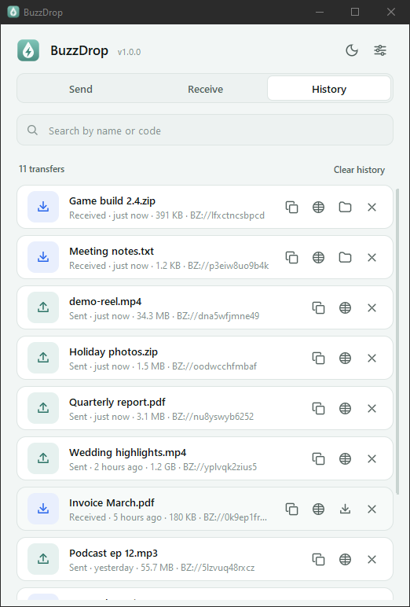
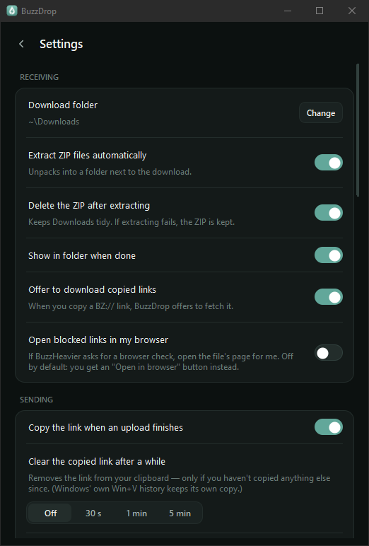

<div align="center">


# BuzzDrop

**Drop a file, get a link. Click a link, get the file.** — powered by [BuzzHeavier](https://buzzheavier.com)

Tiny (~12 MB) · zero dependencies · Windows · macOS · Linux

&nbsp;
&nbsp;


&nbsp;


<sub>Screenshots use sample files. BuzzDrop is an independent, unofficial app and is not affiliated with or endorsed by BuzzHeavier.</sub>

</div>

---

## Download

| System | Get it | First launch |
|---|---|---|
| **Windows 10 / 11** | [`BuzzDrop-windows-x64.exe`](https://github.com/YAYTN/BuzzDrop/releases/latest/download/BuzzDrop-windows-x64.exe) | Just run it — one file, no installer. If SmartScreen appears: **More info → Run anyway**. |
| **Linux** (x86-64) | [`BuzzDrop-linux-x86_64`](https://github.com/YAYTN/BuzzDrop/releases/latest/download/BuzzDrop-linux-x86_64) | `chmod +x BuzzDrop-linux-x86_64 && ./BuzzDrop-linux-x86_64` |
| **macOS** (Apple silicon) | [`BuzzDrop-macos-apple-silicon.zip`](https://github.com/YAYTN/BuzzDrop/releases/latest) *(on the release page, once it has been built)* | Unzip, drag to **Applications**, then **right-click → Open** the first time. |
| **Anything with Python 3.9+** (Intel Macs, ARM Linux, …) | `pipx install git+https://github.com/YAYTN/BuzzDrop` | Run `buzzdrop` (app) or `buzz` (terminal) — or download the source and double-click **`BuzzDrop.pyw`**. |

*The Windows and Linux apps are tested automatically. The macOS app is built the same way but hasn't been tried on a real Mac yet; please [report](https://github.com/YAYTN/BuzzDrop/issues) anything that doesn't work.*

On first launch BuzzDrop makes **BZ:// links open in it** and adds **“Send with BuzzDrop”** to your right-click menu. Everything is per-user (no admin) and can be switched off in **Settings → System integration**.
## Features

**Send**
- Drop files or folders on the window, click to browse, **paste files with Ctrl+V**, or right-click → *Send with BuzzDrop*
- Folders and multi-file bundles are zipped on the fly (already-compressed files are stored, not re-compressed)
- The link is **copied automatically** — choose `BZ://` links or plain `https://` links that are clickable in every chat app
- Optional note shown on the download page
- *Optional:* clear the copied link from your clipboard after 30 s / 1 min / 5 min — only if you haven't copied anything else since
- Select 50 files in Explorer → one window, not 50
- A dropped connection never costs you the upload: it restarts by itself (up to 3 times) and you still get one normal link that works in any browser
- *Optional:* **Settings → Split very large uploads** (or `buzz send --split MB`) sends big files in separate parts, so a drop only repeats one part. BuzzDrop rejoins them and checks every part; `buzz send` also prints a plain link for each part, so nobody needs BuzzDrop to get the file. Off by default

**Receive**
- Click a `BZ://` link anywhere, paste one (or many), or **copy a link and BuzzDrop offers to fetch it**
- **Global hotkey** (Windows, default `Ctrl+Shift+F1`): select a `BZ://` link in Discord, a browser, anywhere — press the hotkey
- **Resumes** after a dropped connection; unfinished files never masquerade as finished ones
- ZIPs are **extracted safely** (zip-slip proof, no double-nested folders, never overwrites) — optional
- Saves to your real Downloads folder, even if you moved it

**Everything else**
- History of everything you sent and received, with search and one-click copy. *Optional privacy setting:* forget it automatically when you quit, or after 1 / 7 / 30 days (only the list is cleared, never your files or links). Off by default
- Light / dark / follow-system theme, six accent colors and five background styles (Default, Ocean, Neutral, Warm, Pure black/white), crisp on high-DPI screens, matching title bar on Windows 11
- Tray icon + start at login (Windows), desktop notifications
- **Quiet updates:** a small "Update to x.y.z" button appears in the header. One click downloads it in the background (checked against the release's SHA-256 and test-started first); nothing restarts until you choose **Restart to finish** or close BuzzDrop. Optional: download updates automatically, or **Skip this version**. The macOS and Linux apps only tell you a new version exists
- A real **command line** for scripts and SSH sessions (`--json` output)
- Portable mode: put a file named `portable` next to the `.exe` and all settings stay in `./data`
- ~30 MB RAM and 0 % CPU while idle

### Keyboard shortcuts

| Keys | Action |
|---|---|
| `Ctrl+V` | Paste files to send, or BZ:// links to download |
| `Ctrl+O` / `Ctrl+Shift+O` | Choose files / a folder to send |
| `Ctrl+1` `Ctrl+2` `Ctrl+3` | Send / Receive / History |
| `Ctrl+,` | Settings |
| `Esc` | Close settings / dismiss notification |

(`⌘` instead of `Ctrl` on macOS.)

## Command line

Turn on **Settings → `buzz` terminal command** (or install with `pipx`) and open a new terminal. On Windows `bz` works too as a shorter alias.

```text
buzz send FILE_OR_FOLDER...   [--note TEXT] [--zip] [--https] [--no-copy] [--json]
buzz get  LINK_OR_CODE...     [-o DIR] [--no-extract] [--json]
buzz setup [--remove]         register / remove BZ:// links, right-click menu, buzz command
buzz update [--check]         look for a new version and install it (packaged Windows app)
buzz uninstall [--yes]        remove BuzzDrop completely, then check nothing is left (--keep-data keeps settings)
buzz                          open the app
```

```console
$ buzz send holiday-photos/
BZ://h0l6lgmru052  holiday-photos.zip
Copied to clipboard.

$ buzz get BZ://h0l6lgmru052 -o ~/Desktop
✓ holiday-photos.zip → /home/me/Desktop/holiday-photos
```

The terminal commands never load the GUI, so they also work on headless servers.

## How it works & privacy

- Uploads use BuzzHeavier's [public API](https://buzzheavier.com/developers) (`PUT https://w.buzzheavier.com/<name>`), streamed from disk — memory use stays flat for any file size.
- Files sent without an account don't stay forever: BuzzHeavier removes them after a few days (it reported about four days when this was written, and BuzzHeavier can change that). Share the link soon after uploading, and send the file again if a link has expired.
- Downloads open the public page for the code, follow its signed download link and stream to `name.part`, which is renamed only when complete.
- BuzzDrop identifies itself honestly (`User-Agent: BuzzDrop/2.x`). BuzzHeavier sometimes asks programs that aren't browsers to pass a browser check. BuzzDrop never tries to get around that or pretends to be a browser: the transfer shows an **Open in browser** button (a download there works as usual), and an optional setting opens the page for you automatically.
- The only other connection is a once-a-day look at this repo's latest GitHub release (switch off in Settings).
- Settings, history and logs live in `%LOCALAPPDATA%\BuzzDrop` (Windows), `~/Library/Application Support/BuzzDrop` (macOS) or `~/.config/buzzdrop` (Linux).

## Troubleshooting

| Problem | Fix |
|---|---|
| The hotkey does nothing | Another app owns it — BuzzDrop tells you; pick a new one in **Settings → Global hotkey**. |
| “Open in your browser” error | BuzzHeavier wanted a browser check for that file. Click **Open in browser** on the transfer (or turn on **Settings → Open blocked links in my browser**). |
| Linux from source: “needs Tk” | `sudo apt install python3-tk` (Debian/Ubuntu) or `sudo dnf install python3-tkinter` (Fedora). The prebuilt binary already includes it. |
| macOS from source: “needs Tk 8.6” | Apple's built-in Python ships an old Tk — use the packaged app or Python from python.org. |
| BZ:// links stopped opening after moving the app | Open the app once from its new location — it re-points the links automatically. |
| Need logs | **Settings → About → Logs** |

**Uninstall:** use **Settings → About → Uninstall…** in the app, **Settings → Apps → BuzzDrop → Uninstall** in Windows, or run `buzz uninstall` in a terminal. It removes everything BuzzDrop set up (links, right-click menu, shortcut, start-at-login, the `buzz` command, your settings and history if you choose, and the program itself), then checks that nothing is left and tells you. Your downloaded files and shared links are never touched. `buzz uninstall --keep-data` keeps your settings and history for a later reinstall.

## Development

```bash
python BuzzDrop.pyw                                 # run from source (no packages needed)
python -m unittest discover -s tests -t .           # 70 tests, offline (local mock server)
BUZZ_GUI_TESTS=1 python -m unittest tests.test_gui  # end-to-end GUI test
pip install pyinstaller && python packaging/build.py  # standalone app for this OS
```

Push a tag (`git tag v1.0.0 && git push --tags`) and GitHub Actions builds the Windows, macOS and Linux apps and publishes the release. Set `BUZZ_NO_INTEGRATION=1` while developing so the app never touches your registry or desktop files. `python tools/make_icons.py` regenerates the icons from the vector logo.

```
buzzdrop/
├── api.py          BuzzHeavier client (streaming upload, resumable download)
├── transfers.py    jobs, queue, packing & extracting
├── cli.py          `buzz` command + app launcher
├── instance.py     single-instance hand-off
├── integration.py  BZ:// links, right-click menu, shortcuts (per OS)
├── winsys.py       Windows: hotkey, tray, drag & drop, title bar
├── config.py       settings, history, logs
├── util.py         links, safe file names, zip helpers
└── gui/            window, widgets, anti-aliased drawing, logo
```

## License

MIT — see [LICENSE](LICENSE).
